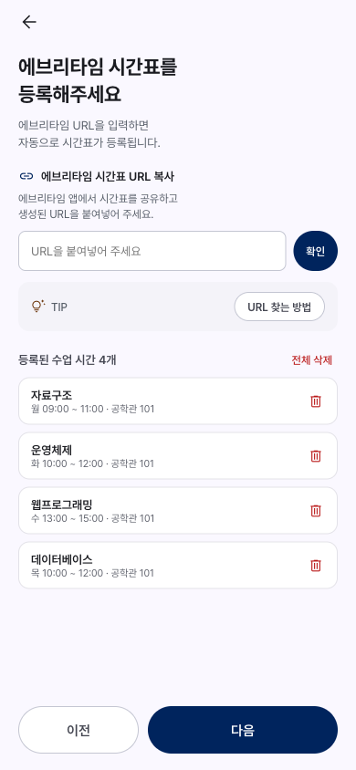
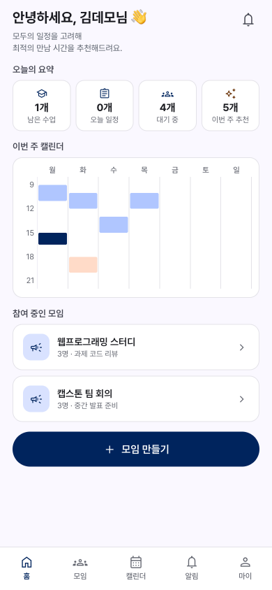
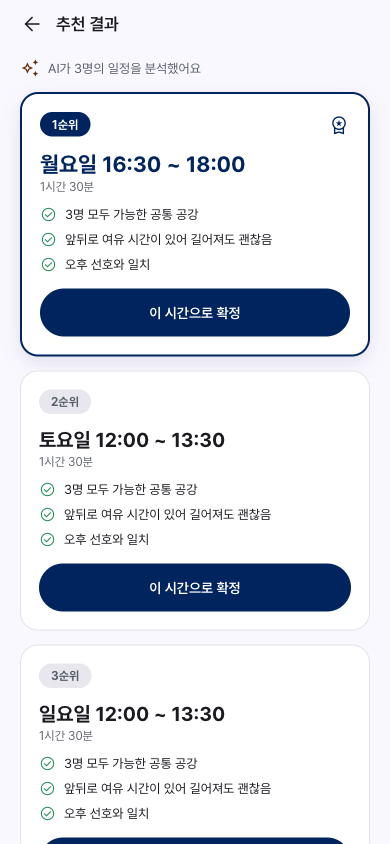
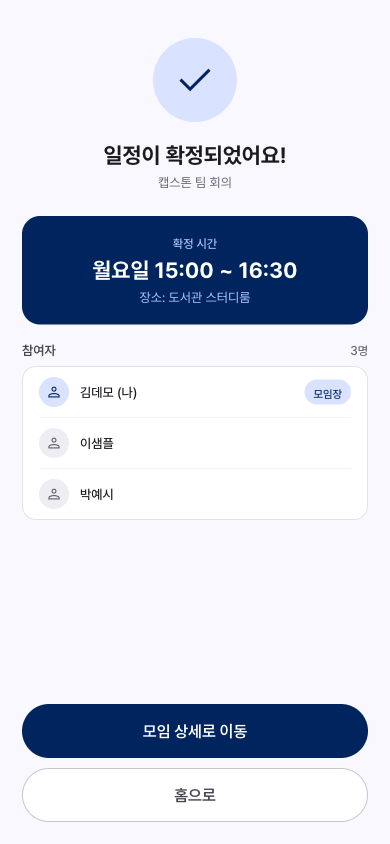
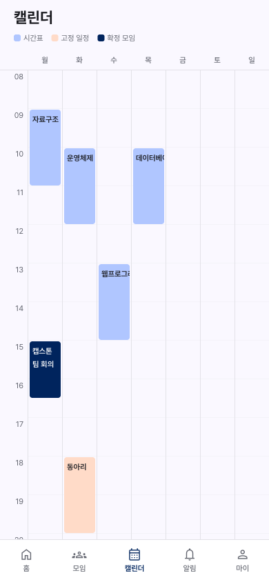
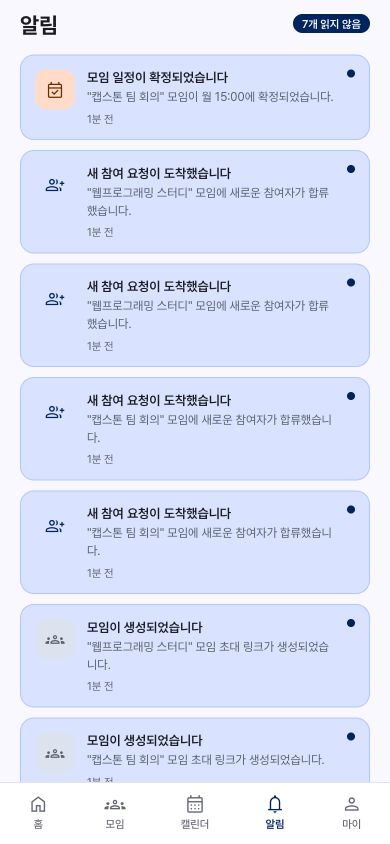
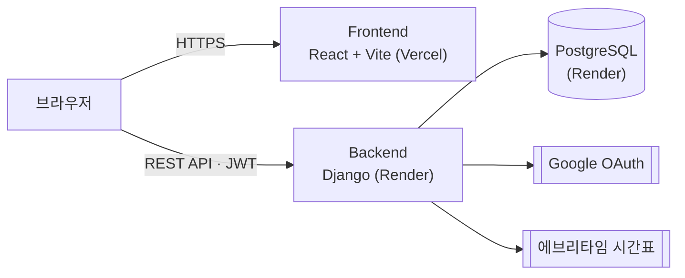

<div align="center">

# SCH-Meet

**순천향대 학생을 위한 시간표 기반 팀 모임 일정 조율 웹앱**

각자 시간표와 고정 일정을 한 번 등록해 두면,
모임에 초대된 팀원 전원이 모일 수 있는 시간을 추천하고 확정까지 한 곳에서 처리합니다.


멋쟁이사자처럼 14기 · 3인 팀 프로젝트

**배포 URL**: https://sch-meet.vercel.app

</div>

> [!NOTE]
> 백엔드는 Render 무료 플랜(https://schmeet-api.onrender.com)에서 동작하므로, 첫 요청 때 서버가 깨어나는 데 최대 1분이 걸릴 수 있습니다.

---

## 목차

- [기획 배경](#기획-배경)
- [화면 구성](#화면-구성)
- [주요 기능](#주요-기능)
- [아키텍처](#아키텍처)
- [기술 스택](#기술-스택)
- [실행 방법](#실행-방법)
- [테스트](#테스트)
- [API 개요](#api-개요)
- [프로젝트 구조](#프로젝트-구조)
- [보안](#보안)
- [문서](#문서)
- [팀원](#팀원)
- [라이선스](#라이선스)

---

## 기획 배경

팀플이나 스터디 모임 시간을 잡으려면 팀원마다 시간표를 물어보고 겹치는 공강을 손으로 찾아야 합니다.

| 문제 | SCH-Meet의 접근 |
|------|----------------|
| 팀원마다 시간표를 물어봐야 함 | 에브리타임 시간표 URL과 고정 일정을 **한 번만 등록** |
| 겹치는 공강을 손으로 찾아야 함 | 참여자 전원의 **공통 빈 시간을 자동 계산** |
| 후보가 여럿이면 고르기 어려움 | 규칙에 따라 점수를 매겨 **추천 이유와 함께 제시** |
| 정해진 일정을 각자 옮겨 적어야 함 | 확정한 일정을 **참여자 시간표에 자동 반영** |

---

## 화면 구성

<table>
  <tr>
    <td align="center" width="33%">
      <br/>
      <sub><b>시간표 등록</b><br/>에브리타임 URL 입력 · 등록된 수업 확인</sub>
    </td>
    <td align="center" width="33%">
      <br/>
      <sub><b>홈</b><br/>오늘의 요약 · 이번 주 캘린더 · 참여 중인 모임</sub>
    </td>
    <td align="center" width="33%">
      <br/>
      <sub><b>추천 결과</b><br/>순위별 후보 시간과 추천 이유</sub>
    </td>
  </tr>
  <tr>
    <td align="center" width="33%">
      <br/>
      <sub><b>일정 확정</b><br/>확정 시간 · 장소 · 참여자</sub>
    </td>
    <td align="center" width="33%">
      <br/>
      <sub><b>캘린더</b><br/>시간표 · 고정 일정 · 확정 모임</sub>
    </td>
    <td align="center" width="33%">
      <br/>
      <sub><b>알림</b><br/>모임 생성 · 참여 · 확정 내역</sub>
    </td>
  </tr>
</table>

> 스크린샷은 로컬 환경에서 가상의 샘플 데이터로 촬영했습니다. 이름과 일정은 모두 실제 학생 정보가 아닙니다.

---

## 주요 기능

| 기능 | 설명 |
|------|------|
| **Google 로그인** | 구글 계정으로 가입하고 로그인합니다. |
| **시간표 등록** | 에브리타임 시간표 URL을 파싱해 등록하고, 등록된 수업을 확인·삭제합니다. 수업을 고정 일정으로 직접 입력할 수도 있습니다. |
| **고정 일정** | 알바·동아리 등 수업 외 반복 일정을 등록·수정·삭제합니다. |
| **모임 생성 / 초대** | 모임 길이(30분~4시간)를 정해 모임을 만들고 초대 링크로 팀원을 모읍니다. |
| **시간 추천** | 참여자 전원의 공통 빈 시간에서 모임 길이만큼 들어갈 시간을 찾고, 공강 길이·참여 인원·희망 시간대·희망 장소·이동 거리를 점수화(규칙 기반)해 후보 시간을 추천 이유와 함께 제시합니다. |
| **일정 확정** | 추천 후보 중 하나로 모임 시간을 확정합니다. 확정된 일정은 참여자 시간표에 반영되고, 모임 삭제·탈퇴 시 자동으로 정리됩니다. |
| **캘린더 / 대시보드** | 내 시간표와 모임 일정을 캘린더와 홈 화면에서 확인합니다. |
| **알림** | 모임 생성·참여·확정 알림 내역을 확인합니다. |

---

## 아키텍처



`render.yaml`은 Render 블루프린트이고, `deploy/`에는 프론트·API·DB를 한 서버에 올리는 OCI용 Compose 구성이 있습니다.

---

## 기술 스택

| 영역 | 기술 |
|------|------|
| Frontend | React 18 · Vite 8 · React Router 7 |
| Backend | Django 6.0 · Python 3.12 · django-cors-headers |
| 인증 | Google 로그인(google-auth) · JWT(PyJWT) |
| 데이터 | SQLite(로컬) · PostgreSQL(배포) |
| 배포 | Vercel(Frontend) · Render(Backend + PostgreSQL) |
| CI | GitHub Actions(테스트 · 빌드 · `pip-audit` · `npm audit`) |

---

## 실행 방법

### 준비물

- Python 3.12 이상
- Node.js (버전은 `frontend/.nvmrc` 참고)

### 1. 저장소 클론

```bash
git clone https://github.com/KimHands/sch-meet.git
cd sch-meet
```

### 2. Backend

```bash
cd server
python -m venv venv
source venv/bin/activate   # Windows: venv\Scripts\activate
pip install -r requirements.txt

cp .env.example .env       # 아래 환경변수 참고

python manage.py migrate
python manage.py runserver 8080
# → http://localhost:8080
```

### 3. Frontend

```bash
cd frontend
npm install

cp .env.example .env       # VITE_API_BASE_URL=http://localhost:8080

npm run dev
# → http://localhost:5173
```

### 환경변수

**Backend (`server/.env`)**

| 키 | 설명 |
|----|------|
| `DJANGO_SECRET_KEY` | 필수. 미설정 시 서버가 기동되지 않음 |
| `DJANGO_DEBUG` | 로컬 개발에서만 `True` |
| `DJANGO_ALLOWED_HOSTS` | 추가 허용 호스트(콤마 구분) |
| `DJANGO_ADMIN_ENABLED` | 관리자 페이지 노출 여부(기본 비노출) |
| `FRONTEND_ORIGINS` / `FRONTEND_BASE_URL` | CORS 허용 오리진 / 초대 링크용 프론트 주소 |
| `DATABASE_URL` | 비워 두면 로컬 SQLite 사용 |
| `GOOGLE_CLIENT_ID` / `GOOGLE_CLIENT_SECRET` | Google OAuth |

전체 목록은 `server/.env.example`을 참고하세요.

**Frontend (`frontend/.env`)**

| 키 | 설명 |
|----|------|
| `VITE_API_BASE_URL` | 백엔드 주소 |
| `VITE_GOOGLE_CLIENT_ID` | Google OAuth 클라이언트 ID |

> [!WARNING]
> `.env` 파일과 API 키 값은 Git에 올리지 않습니다. 운영 값은 배포 플랫폼 대시보드에만 입력합니다.

---

## 테스트

```bash
# Backend
cd server && python manage.py test api

# Frontend
cd frontend && npm test
```

Pull Request와 `main` 푸시마다 GitHub Actions가 테스트와 빌드, 의존성 취약점 검사를 실행합니다.

---

## API 개요

Base URL: `/api` · 인증이 필요한 요청은 JWT를 사용합니다.

| 모듈 | 주요 엔드포인트 |
|------|---------------|
| 상태 확인 | `/health/` |
| 인증 | `/auth/login/` · `/auth/refresh/` |
| 사용자 | `/users/me/` |
| 시간표 | `/timetables/upload-url/` · `/timetables/classes/` · `/timetables/classes/{id}/` · `/timetables/consolidated/` |
| 고정 일정 | `/schedules/fixed/` · `/schedules/fixed/{id}/` |
| 모임 | `/meetings/` · `/meetings/{id}/` |
| 초대 | `/meetings/invite/{token}/` · `/meetings/invite/{token}/join/` |
| 추천 · 확정 | `/meetings/{id}/recommendations/` · `/meetings/{id}/confirm/` · `/meetings/{id}/confirmed/` |
| 대시보드 | `/dashboard/summary/` |
| 알림 | `/notifications/` · `/notifications/read/{id}/` |

---

## 프로젝트 구조

```
sch-meet/
├── frontend/              React + Vite
│   ├── src/
│   │   ├── api/           API 클라이언트
│   │   ├── components/    공통 컴포넌트
│   │   ├── pages/         화면 단위 컴포넌트
│   │   └── App.jsx        라우팅
│   └── vercel.json
├── server/                Django
│   ├── config/            프로젝트 설정
│   ├── apps/api/          API 앱(endpoints/, tests/)
│   ├── requirements.txt
│   └── build.sh           Render 빌드 스크립트
├── deploy/                OCI용 Compose 구성
├── docs/                  기획 · 명세 · 배포 문서, 스크린샷
├── .github/workflows/     CI
└── render.yaml            Render 블루프린트
```

---

## 보안

- Google 로그인은 이메일 인증된 계정만 허용하고, JWT(access 60분 / refresh 7일)로 인증합니다.
- 로그인·토큰 갱신·시간표 연동에 요청 횟수 제한을 둡니다.
- 외부 XML은 defusedxml로 파싱합니다.
- 운영에서는 HTTPS 리다이렉트·HSTS·보안 쿠키를 켜고, 프론트는 CSP 등 보안 헤더를 붙입니다.
- CI에서 `pip-audit`와 `npm audit`로 의존성 취약점을 검사합니다.

---

## 문서

| 문서 | 내용 |
|------|------|
| [`docs/01_기획서.pdf`](docs/01_기획서.pdf) | 기획서 |
| [`docs/02_기능명세서.md`](docs/02_기능명세서.md) | 기능 명세 |
| [`docs/deploy/DEPLOY.md`](docs/deploy/DEPLOY.md) | Vercel · Render 배포 |
| [`deploy/README.md`](deploy/README.md) | OCI 서버 배포 |

---

## 팀원

| GitHub | 역할 | 담당 |
|--------|------|------|
| [@asohee48](https://github.com/asohee48) | Frontend | 전체 화면 UI, 온보딩·마이페이지, 백엔드 API 연동 |
| [@Asnko](https://github.com/Asnko) | Backend | Django 초기 설정, Google 로그인, 에브리타임 시간표 파싱·고정 일정, 모임·초대, 추천 알고리즘, 대시보드·알림 |
| [@KimHands](https://github.com/KimHands) | 프로젝트 총괄 | Vercel·Render 배포, 보안 설정 |

---

## 라이선스

[MIT License](LICENSE)

이 프로젝트는 멋쟁이사자처럼 14기 SCH 교육 과정의 일환으로 제작되었습니다.
